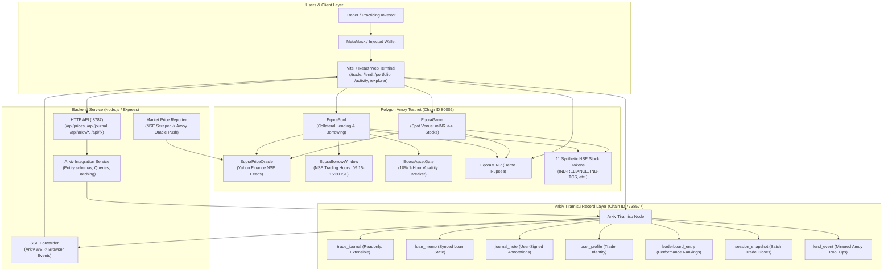

# EQORA — System Architecture

EQORA is a blockchain-based Indian-stock practice trading and collateral-lending platform with an unfakeable on-chain activity journal powered by **Arkiv**.

---

## 1. Smart Contract Architecture (Polygon Amoy)

The smart contracts are written in Solidity `0.8.27` and deployed on the Polygon Amoy testnet:

### Core Contracts:
1. **`EqoraPriceOracle`**:
   - Stores 8-decimal NSE stock prices updated by the authorized reporter.
   - Rejects prices older than 24 hours (`stalePriceThreshold`) to prevent execution on stale market information.
2. **`EqoraBorrowWindow`**:
   - Enforces National Stock Exchange (NSE) trading hours (Monday–Friday, 09:15–15:30 IST).
   - Blocks new collateral borrowing outside market hours while permitting repayments at any time.
3. **`EqoraAssetGate`**:
   - Acts as an automatic circuit breaker.
   - If an underlying stock experiences greater than a 10% price shift within one hour, collateral borrowing against that asset is paused.
4. **`EqoraPool`**:
   - Overcollateralized lending pool.
   - Accepts synthetic NSE stock tokens (`IND-RELIANCE`, `IND-TCS`, etc.) as collateral with asset-specific Loan-to-Value (LTV) limits (typically 65–75%).
   - Borrows `EqoraMINR` (mock Indian Rupees) at dynamic borrow rates.
   - Enforces liquidation threshold (75–85%) with a 5% bonus for liquidators.
5. **`EqoraGame`**:
   - Single-step spot practice venue.
   - Quotes trades with a 0.30% execution fee and executes atomically with user-specified slippage protection (minimum output).
6. **`EqoraMINR`**:
   - Standard ERC-20 token with a 10,000 mINR faucet for demo trading.
7. **Synthetic Stock Tokens**:
   - 11 ERC-20 tokens representing Indian equities:
     `IND-RELIANCE`, `IND-TCS`, `IND-HDFCBANK`, `IND-ICICIBANK`, `IND-INFY`, `IND-HINDUNILVR`, `IND-ITC`, `IND-SBIN`, `IND-BHARTIARTL`, `IND-LT`, and the benchmark index `IND-NIFTY`.

---

## 2. Arkiv Record Layer (Tiramisu Testnet)

EQORA utilizes **Arkiv Tiramisu** as an immutable, structured record database. Rather than relying on centralized databases or volatile off-chain storage, every critical trading and lending action generates a structured Arkiv entity:

### The 7 Entity Types:
1. **`trade_journal`**: Closed trades with exact millisecond timestamps, P&L in basis points (`i32`), wei-exact size (`u256`), and execution price. Created with `{ readonly: true, permissionlessExtension: true }` so the record cannot be tampered with while allowing community lease extensions.
2. **`loan_memo`**: Synced lending positions detailing supplied collateral, borrowed mINR, and health factor.
3. **`journal_note`**: Trader notes and trade commentary signed directly by the user via MetaMask.
4. **`user_profile`**: Trader handle, bio, and avatar records owned by the trader.
5. **`leaderboard_entry`**: Aggregated performance rankings computed from closed journal entries.
6. **`session_snapshot`**: Grouped session trade logs linked via `predictEntityKeys`.
7. **`lend_event`**: Polygon Amoy supply, borrow, repay, and withdraw events mirrored onto Tiramisu.

---

## 3. Backend Service Architecture

The backend provides essential off-chain services without custody of user assets:
- **Price Reporter**: Fetches NSE market data from Yahoo Finance API and periodically pushes price feeds to `EqoraPriceOracle` on Amoy.
- **Arkiv Server**: Handles entity queries, cursor pagination, batch closing, and fallback queries for node-level operator gaps.
- **SSE Bridge**: Subscribes to Arkiv WebSocket events (`watchJournalEvents`) and forwards them to connected browsers via Server-Sent Events (SSE).
- **Display FX Cache**: Caches USD/INR exchange rates for display toggling without altering on-chain settlement.
- **Secret Redaction**: Automatically scrubs any access tokens or sensitive request URLs from outgoing error responses.

---

## 4. Frontend Terminal Architecture

The frontend is a lightweight, responsive React terminal built with Vite:
- **Trade Workspace**: Lightweight Charts candlestick chart, multi-timeframe views (5m to 1mo), real-time order quotes, slippage limits, and one-click execution.
- **Lend Pool Workspace**: Market supply, borrow, collateral health factor monitoring, and liquidation alerts.
- **Portfolio**: Balances, supplied assets, open borrow debt, and trade history.
- **Activity**: Live SSE event feed from Arkiv with filterable tabs for journals, notes, memos, and profiles.
- **Explorer**: Direct record browser allowing users to verify any entity on the official Arkiv Tiramisu Explorer.
- **Currency Toggle**: Dual ₹ INR / $ USD display formatting.
